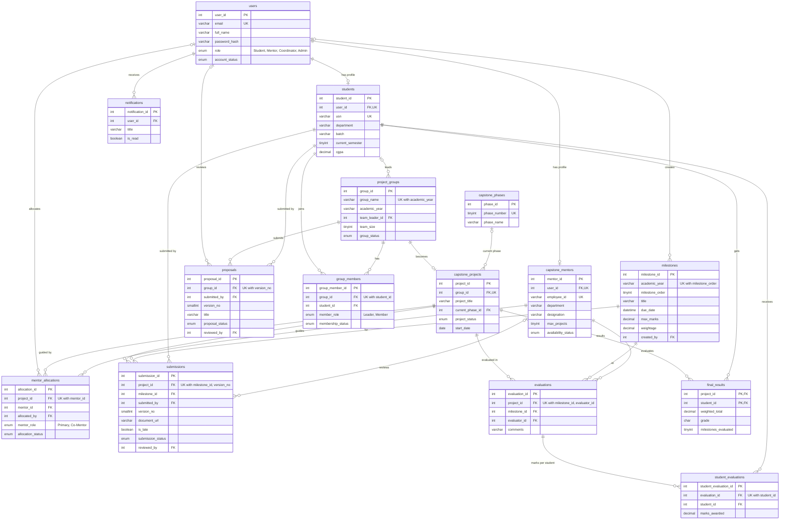

# CPMS Database Design

This document covers the relational (MySQL) side of CPMS: the ER diagram, how each relationship is implemented, and the normalization of every table.

**At a glance** (`cpms_db`, MySQL 8.0.16+)

| Object | Count | Where |
| :--- | :--- | :--- |
| Tables | 15 | `db/001_core_schema.sql`, `db/002_workflow_schema.sql` |
| Foreign keys | 26 | same files |
| CHECK constraints | 15 | same files |
| Views | 9 | `db/003_views.sql` |
| Triggers | 13 | `db/004_triggers_procedures.sql` |
| Stored procedures | 3 (`sp_allocate_guide`, `sp_review_proposal`, `sp_calculate_final_marks`) | `db/004_triggers_procedures.sql` |
| Functions | 1 (`fn_grade`) | `db/004_triggers_procedures.sql` |

---

## 1. ER Diagram

Crow's-foot notation. `||` means exactly one, `o|` means zero or one, `o{` means zero or more. PK = primary key, FK = foreign key, UK = unique key.

The diagram below renders on GitHub. The same diagram is in [`er-diagram.png`](er-diagram.png) and [`er-diagram.svg`](er-diagram.svg) for slides and reports, and its source is [`er-diagram.mmd`](er-diagram.mmd).

Only the key and most important columns are shown. Every column is in the SQL files.

### Entities

| Table | What one row is |
| :--- | :--- |
| `users` | One login account (any role) |
| `students` | The academic profile of a student account |
| `capstone_mentors` | The faculty profile of a mentor account |
| `project_groups` | A capstone team for one academic year |
| `group_members` | One student's membership in one group, with join/leave history |
| `capstone_phases` | A lifecycle phase (lookup table, 5 rows) |
| `capstone_projects` | The official project of a group, created when its proposal is approved |
| `mentor_allocations` | One faculty guide assigned to one project |
| `proposals` | One version of a group's project proposal |
| `milestones` | A review checkpoint for an academic year, with due date, max marks and weightage |
| `submissions` | One version of a document a project submits for a milestone |
| `evaluations` | One evaluator's review of one project at one milestone |
| `student_evaluations` | The marks one student got in one evaluation |
| `final_results` | A student's weighted total and grade for a project (computed) |
| `notifications` | An in-app message to a user (mostly written by triggers) |

### How each relationship is implemented

| Relationship | Cardinality | Implementation |
| :--- | :--- | :--- |
| User → student profile | 1 : 0..1 | `students.user_id` FK + UNIQUE |
| User → mentor profile | 1 : 0..1 | `capstone_mentors.user_id` FK + UNIQUE |
| Student ↔ group | M : N | Junction table `group_members`, UNIQUE (`group_id`, `student_id`) |
| Group → project | 1 : 0..1 | `capstone_projects.group_id` FK + UNIQUE |
| Group → proposals | 1 : N | `proposals.group_id` FK, version numbered per group |
| Project ↔ mentor | M : N | Junction table `mentor_allocations`, UNIQUE (`project_id`, `mentor_id`), with role and status |
| Project × milestone → submissions | 1 : N each | `submissions` FKs, UNIQUE (`project_id`, `milestone_id`, `version_no`) |
| Project × milestone × mentor → evaluation | ternary | `evaluations`, UNIQUE (`project_id`, `milestone_id`, `evaluator_id`) |
| Evaluation ↔ student (marks) | M : N | Junction table `student_evaluations`, carries `marks_awarded` |
| Project ↔ student (result) | M : N | `final_results`, composite PK (`project_id`, `student_id`) |

**ISA / specialisation:** `students` and `capstone_mentors` are specialisations of `users`. Shared attributes (name, email, password, role) live once in `users`; role-specific attributes live in the sub-tables, linked 1:1 by `user_id`.

**Referential actions:** child rows that cannot exist without their parent use `ON DELETE CASCADE` (deleting a group removes its members, proposals and project). Optional "who did it" references (`reviewed_by`, `allocated_by`, `created_by`, `team_leader_id`, `current_phase_id`) use `ON DELETE SET NULL`, so history survives when the person or phase is removed.

---

## 2. Normalization

**Summary:** the 14 tables that hold entered data are in **3NF** and also in **BCNF**: within each table, every determinant is a candidate key (see 2.4). The 15th, `final_results`, is a stored computed result: `sp_calculate_final_marks` derives all of its columns from the marks tables. Separately, a few values are stored even though they could be derived from *other* tables. That is cross-table redundancy, not a normal-form violation, and each case is deliberate, documented, and kept consistent by the application or the database (see 2.5).

### 2.1 First Normal Form (1NF): atomic values, no repeating groups

- Every column holds one value. A group's members are not stored as a list such as `"Aarav, Diya, Rohan"` in `project_groups`. Each membership is its own row in `group_members`.
- Marks are not stored as repeating columns (`student1_marks`, `student2_marks`, ...) in `evaluations`. Each student's mark is a row in `student_evaluations`.
- Every table has a primary key, so there are no duplicate rows.

### 2.2 Second Normal Form (2NF): no partial dependency on part of a key

2NF only matters for tables whose key has more than one column. The clearest example in this schema is the split between `evaluations` and `student_evaluations`:

- An evaluation is identified by (`project_id`, `milestone_id`, `evaluator_id`). Its `comments` depend on that whole key.
- `marks_awarded` depends on (evaluation, **student**). If marks were stored in `evaluations` with a `student_id` column, the key would become (`project_id`, `milestone_id`, `evaluator_id`, `student_id`), and `comments` would depend on only part of it. The comment would then be repeated for every student. That is a partial dependency, so marks were moved to `student_evaluations`.

The same reasoning applies to `final_results`: `weighted_total`, `grade` and `milestones_evaluated` depend on the whole key (`project_id`, `student_id`), not on the project alone or the student alone.

### 2.3 Third Normal Form (3NF): no transitive dependency

A non-key column must not depend on another non-key column. Examples of how the design avoids this:

| Possible transitive dependency | How it is avoided |
| :--- | :--- |
| `students.student_id → user_id → full_name, email` | Name and email are only in `users`. `students` stores just `user_id`. |
| `mentor_allocations.mentor_id → mentor name, department` | Only `mentor_id` is stored. Details come from `capstone_mentors` and `users`. |
| `student_evaluations.evaluation_id → milestone_id → max_marks, weightage` | `max_marks` and `weightage` are only in `milestones`. The view `v_student_milestone_marks` joins them in. |
| `submissions.milestone_id → due_date` | The due date is only in `milestones`. `is_late` is computed once by a trigger at insert time and then fixed (see 2.5). |
| `capstone_projects.current_phase_id → phase_name` | Phase names are only in the `capstone_phases` lookup table. |
| Mentor workload (active projects) | Not stored. Computed by the view `v_mentor_workload`. |

### 2.4 Candidate keys and functional dependencies (BCNF check)

BCNF requires that every determinant (left side of a functional dependency) is a candidate key. For each table, the only determinants are its candidate keys:

| Table | Candidate keys | Main functional dependencies |
| :--- | :--- | :--- |
| `users` | `user_id`, `email` | `user_id → email, full_name, password_hash, role, account_status` |
| `students` | `student_id`, `user_id`, `usn` | `student_id → user_id, usn, department, batch, semester, cgpa, ...` |
| `capstone_mentors` | `mentor_id`, `user_id`, `employee_id` | `mentor_id → department, designation, max_projects, availability, ...` |
| `project_groups` | `group_id`, (`group_name`, `academic_year`) | `group_id → group_name, academic_year, batch, department, status, ...` |
| `group_members` | `group_member_id`, (`group_id`, `student_id`) | `(group_id, student_id) → member_role, membership_status, joined_at, left_at` |
| `capstone_phases` | `phase_id`, `phase_number` | `phase_id → phase_number, phase_name, description` |
| `capstone_projects` | `project_id`, `group_id` | `project_id → group_id, title, status, phase, dates, ...` |
| `mentor_allocations` | `allocation_id`, (`project_id`, `mentor_id`) | `(project_id, mentor_id) → mentor_role, allocation_status, dates, remarks` |
| `proposals` | `proposal_id`, (`group_id`, `version_no`) | `(group_id, version_no) → title, abstract, status, review fields, ...` |
| `milestones` | `milestone_id`, (`academic_year`, `milestone_order`) | `milestone_id → title, due_date, max_marks, weightage` |
| `submissions` | `submission_id`, (`project_id`, `milestone_id`, `version_no`) | `submission_id → document, submitted_at, is_late, status, review fields` |
| `evaluations` | `evaluation_id`, (`project_id`, `milestone_id`, `evaluator_id`) | `evaluation_id → comments, evaluated_at` |
| `student_evaluations` | `student_evaluation_id`, (`evaluation_id`, `student_id`) | `(evaluation_id, student_id) → marks_awarded, remarks` |
| `final_results` | (`project_id`, `student_id`) | `(project_id, student_id) → weighted_total, grade, milestones_evaluated` |
| `notifications` | `notification_id` | `notification_id → user_id, title, message, link, is_read` |

**A likely viva question:** "In `final_results`, doesn't `weighted_total → grade` break BCNF?" Not quite: the grade is `'IP'` (in progress) until every milestone of the year is evaluated, so the same total can be `IP` or `F`. But the honest answer is that `final_results` is not part of the normalized core at all. Every column in it is computed by `sp_calculate_final_marks` from `student_evaluations` and `milestones`. It is a stored result table, kept for fast reports and a timestamped record of each calculation, and it is recomputed from the source data whenever marks change (see 2.5). The source data it comes from is in BCNF.

Surrogate keys (`*_id AUTO_INCREMENT`) are used as primary keys for simple, stable foreign keys. The natural keys are still enforced with UNIQUE constraints, so the surrogate key never hides a duplicate.

### 2.5 Deliberate denormalization (and why)

These are the only stored values that could be derived from other data. Stating them openly is better than claiming the schema is perfectly normalized.

| Column | Could be derived from | Why it is stored | How consistency is kept |
| :--- | :--- | :--- | :--- |
| `project_groups.team_size` | `COUNT(*)` of active `group_members` | Fast listing and filtering of groups; the CHECK (1 to 4) gives a hard cap on team size | Updated in the same transaction that adds or removes a member (`src/lib/groups/service.ts`) |
| `project_groups.team_leader_id` | `group_members` row with `member_role = 'Leader'` | Direct FK makes "who leads this group" a simple join | Set by the same group-management transaction |
| `final_results.*` | `v_student_milestone_marks` | A stable, reportable result table; grade history has a `calculated_at` time | Recomputed by `sp_calculate_final_marks` every time marks are saved |
| `submissions.is_late` | `submitted_at > milestones.due_date` | Lateness must reflect the due date **at the time of submission**. If the coordinator later extends a due date, earlier late submissions must stay late. | Set once by `trg_submissions_before_insert` |
| `submissions.version_no`, `proposals.version_no` | Row order within the group/project | Gives each version a permanent number | Set by `BEFORE INSERT` triggers, protected by UNIQUE constraints |
| `capstone_projects.project_title`, `problem_statement`, ... | The approved `proposals` row | The project can be edited after approval without changing the historical proposal | Copied once by `sp_review_proposal` on approval |

`department` and `batch` are plain text columns rather than FKs to a `departments` lookup table. This is not a normal-form violation (they are attributes of the student, mentor or group). A lookup table would be a sensible next step to prevent spelling variations.
